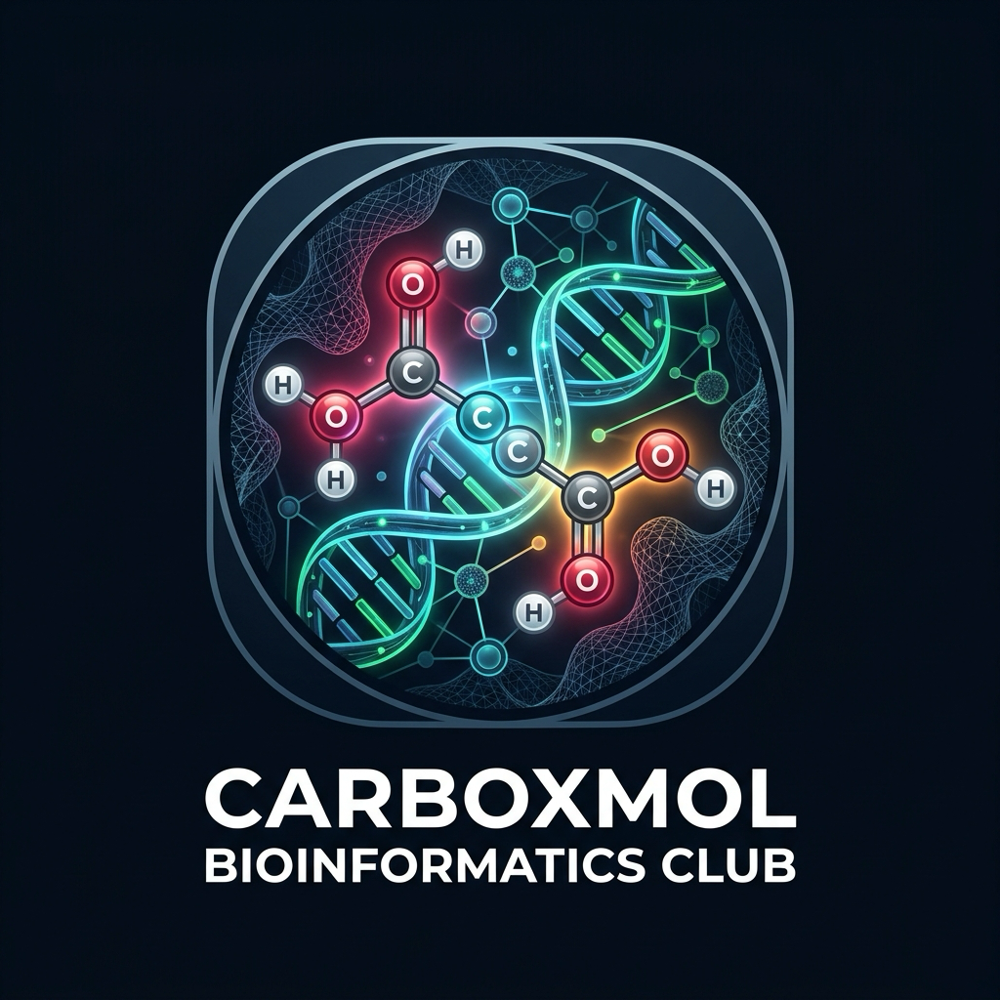

# 🌐 CarboxMol Bioinformatics Club — Official Web Platform
### *The Official Portal & Progressive Web App for CarboxMol Bioinformatics Club*

  
  <h2>CarboxMol Bioinformatika Klubu</h2>
  
<strong>Rəsmi Veb Ünvan:</strong> <a href="https://carboxmol-bioinformatics-club.github.io">https://carboxmol-bioinformatics-club.github.io</a>

  
<em>Hesablama Biologiyası, Struktur Genomika, Carbox & CarboxMol, Python, R və Süni İntellekt Mərkəzi</em>

---

## 🚀 Repozitoriya Haqqında

Bu repozitoriya **CarboxMol Bioinformatika Klubu**nun qlobal CDN üzərində yayımlanan rəsmi veb platformasıdır (`CarboxMol-Bioinformatics-Club.github.io`).

Əsas backend, verilənlər bazası, tədris alqoritmləri və tədqiqat sənədləri üçün əsas repozitoriyaya müraciət edin:
👉 **[CarboxMol-Bioinformatics-Club / CarboxMol-Bioinformatics-Club](https://github.com/CarboxMol-Bioinformatics-Club/CarboxMol-Bioinformatics-Club)**

---

## ✨ Əsas Xüsusiyyətlər
- 📱 **PWA & Tam Oflayn Dəstək:** Bütün brauzerlərdə və əməliyyat sistemlərində internetsiz (oflayn) işləmə qabiliyyəti.
- 🧬 **İnteraktiv Bio-Alətlər:** DNT/RNT/Zülal ardıcıllıq analizi (SeqAnalyzer) və Bioconductor R kodu icraçısı.
- 🎥 **CarboxMol BioMeet:** Canlı dərs zalı, audio/video qeydiyyatçısı və interaktiv studiya.
- 📜 **İnteqrasiya olunmuş Sənəd Baxış Modulu:** Rəsmi ərizə, nizamnamə, sillabus və strukturların brauzerdaxili oxunması və PDF yüklənməsi.
- 🛡️ **Tələbə & Rəhbərlik Panelləri:** Üzvlük müraciətlərinin idarəsi, kiber müdafiəli təsdiq mexanizmi.

---

## 📬 Əlaqə
- **Sayt:** [CarboxMol-Bioinformatics-Club.github.io](https://carboxmol-bioinformatics-club.github.io)
- **Təşkilat:** [github.com/CarboxMol-Bioinformatics-Club](https://github.com/CarboxMol-Bioinformatics-Club)
- **Klub Sədri:** Süleyman Mehdi oğlu Hacızadə (+994 70 550 69 07 | suleyman.hacizade.232bioing@wcu.edu.az)
