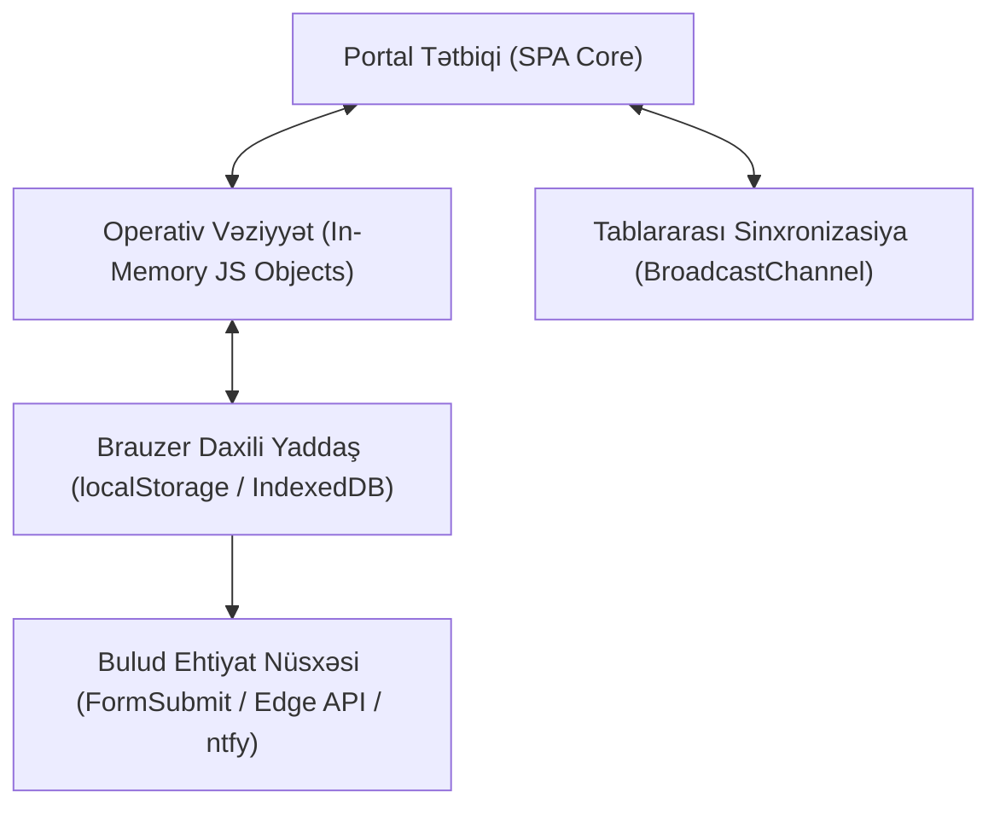

# 🗄️ Məlumat Bazası və Vəziyyətin İdarəsi (State Management)

[[carboxmol_bioinformatics_club|CarboxMol Bioinformatika Klubu]] portalı **Local-First (Birinci Yerli Yaddaş)** fəlsəfəsi ilə qurulmuşdur. Bu o deməkdir ki, istifadəçinin brauzeri sadəcə passiv bir "vizual pəncərə" deyil, tam hüquqlu müstəqil verilənlər bazası düyünüdür.

---

## 🏗️ Üçqatlı Saxlama Qatı (Storage Tiers)

1. **`js/data.js` (İlkin Seed Məlumatları):**
   * Tətbiq ilk dəfə açıldıqda əsas məlumat strukturu (`INITIAL_DATA`) klub üzvləri, mentorlar, tapşırıqlar və tədris modulları ilə yüklənir.
2. **`localStorage` (Yerli Davamlılıq):**
   * Əsas açarlar:
     * `wcu_bioinfo_club_data`: Bütün üzvlər, təsdiqlər, qiymətlər və daxili parametrlər.
     * `wcu_offline_sync_queue`: İnternet olmadığı vaxt toplanan müraciətlər növbəsi.
     * `wcu_active_member_id` / `wcu_active_teacher_id`: Cari aktiv sessiya.
3. **`window.SyncEngine` (Pəncərələr Arası Canlı Əlaqə):**
   * `BroadcastChannel("carboxmol_bioinfo_club_sync")`: İstifadəçi bir tabda müəllim qeydiyyatından keçdikdə və ya tapşırıq göndərdikdə digər bütün açıq brauzer pəncərələri dərhal xəbərdar edilir və UI yenilənir.
4. **Tam JSON Backup & Restore:**
   * Sədr portalında tək bir kliklə bütün klubun 100% məlumatları `.json` faylı kimi kompüterə endirilə və ya digər kompüterə köçürülə bilər.

---

## 🔗 Əlaqəli Səhifələr
* [[system_architecture]]
* [[pwa_offline_architecture]]
* [[club_security_and_auth_architecture]]
