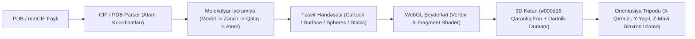

# 🎮 Mol* WebGL 3D Qrafika və Render Boru Kəməri

[[carboxmol_studio|CarboxMol 3D Studiyası]]nın vizual nüvəsi müasir molekulyar qrafikanın qlobal standartı olan **Mol\*** (*MolStar*) texnologiyası üzərində qurulmuşdur. Bu sənəd atomik koordinatların ekranda yüksək dəqiqlikli 3D təsvirə çevrilməsinin texniki mühəndisliyini izah edir.

---

## 🔄 Qrafik Boru Kəmərinin Mərhələləri

### 1. Fayl Analizi və İyerarxiya:
* Sayt `assets/models/1BNA.pdb`, `4I8V.pdb`, `4GV1.pdb` fayllarını Web Worker vasitəsilə asinxron yükləyir.
* Hər bir atom üçün 3D vektor ($x, y, z$), element növü, $B$-faktor (istilik rəqsi) və doluluq (*occupancy*) parse edilir.

### 2. Həndəsi Təsvirlərin (Representations) Qurulması:
* **Karikatura (Cartoon):** Peptid rabitəsinin $C_\alpha$ izləri boyunca splayn əyriləri çəkilir, $\alpha$-helikslər üçün spiral lentlər, $\beta$-vərəqlər üçün oxlu zolaqlar generasiya olunur.
* **Sferik (Spacefill / VDW):** Hər atom öz van der Waals radiusunda qapalı 3D sfera kimi render edilir.
* **Molekulyar Səth (Solvent Excluded Surface):** $1.4\text{ \AA}$ radiuslu su zondu zülalın üzərində yuvarladılaraq həlledicidən təcrid olunmuş xarici qabıq hesablanır.
* **Çubuqlar (Sticks):** Atomlararası kovalent rabitələr silindrlər şəklində göstərilir.

### 3. İşıqlandırma, Dərinlik Dumanı (Depth Fog) və Rəng Palitrası:
* **Kristalloqrafik Qaranlıq Fon:** `#090d16` (dərin gecə mavisi/qara).
* **Dərinlik Dumanı:** Kameradan uzaqlaşan zülal hissələri tədricən tünd qaranlıq duman daxilində görünməz olur (`fogStart = 0.22`, `enableFog(true)`). Bu, 2D ekranda inanılmaz 3D dərinlik hissi yaradır.
* **Kamera Tripodu (Orientation Tripod):** Kamera fırlandıqca küncdəki kiçik 2D kətan üzərində fəza oxları dinamik fırlanır:
  * **X Oxu:** Qırmızı vektor
  * **Y Oxu:** Zümrüd yaşılı vektor
  * **Z Oxu:** Parlaq sian vektor

---

## 🔗 Əlaqəli Səhifələr
* [[carboxmol_studio]]
* [[system_architecture]]
* [[macromolecular_crystallography]]
* [[pdb_1bna_bdna]]
* [[pdb_4i8v_cyp1a1]]
* [[pdb_4gv1_akt1]]
