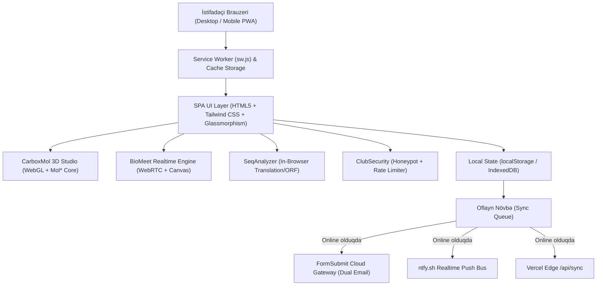

# 🏗️ CarboxMol Platformasının Tam Sistem Arxitekturası

CarboxMol Bioinformatika Klubu platforması müasir, serverless, oflayn işləyən (*local-first*) və yüksək dərəcədə optimallaşdırılmış SPA (Single Page Application) mühəndisliyinə əsaslanır.

---

## 🧩 Əsas Arxitektura Modulları

1. **İstifadəçi İnterfeysi (UI & Design System):**
   * **Stil:** Müasir elmi qaranlıq şüşə (*dark glassmorphic*) estetikası.
   * **3D Qorunması:** Qlobal açıq rəngli CSS qaydalarının 3D kətanı korlamaması üçün `#molStudioWrapper` xüsusi izolyasiya edilmiş stillərlə mühafizə olunur.
2. **Molekulyar Qrafika Alt-sistemi (3D Studio):**
   * `js/mol-viewer.js`: Mol* (MolStar) bazasında qurulub. Tünd kristalloqrafik fon (`#090d16`), dərinlik dumanı (*depth fog*) və kamera fırlandıqca real vaxtda sinxronlaşan **X (qırmızı), Y (yaşıl), Z (mavi) orientasiya tripodu**.
3. **Məlumat Saxlanması və Yerli Baza (Local-First Data Model):**
   * Bütün klub üzvləri, tapşırıqlar, qiymətləndirmələr və elanlar `js/data.js` daxilində və `localStorage`-də saxlanılır. İnternet olmadan da bütün sistem sürətlə işləyir.
4. **Çarpaz Pəncərə Sinxronizasiyası (`window.SyncEngine`):**
   * İstifadəçi bir tabda qeydiyyatdan keçdikdə və ya dəyişiklik etdikdə `BroadcastChannel` vasitəsilə digər açıq pəncərələrə bildiriş gedir və ekran yenilənmədən UI sinxronlaşır.

---

## 🔗 Əlaqəli Səhifələr
* [[pwa_offline_architecture]]
* [[club_security_and_auth_architecture]]
* [[carboxmol_studio]]
* [[biomeet_platform]]
* [[seqanalyzer_tool]]
