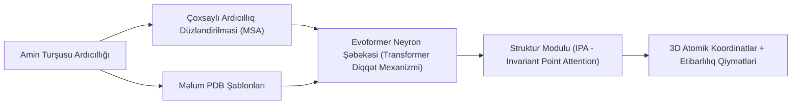

# 🤖 AlphaFold və Süni İntellektlə Zülal Qatlanması

**Zülal qatlanması problemi (Protein Folding Problem)** — 50 ildən artıq müddətdə biologiyanın ən böyük tapmacalarından biri olmuşdur: *Birölçülü amin turşusu ardıcıllığından onun fəzada üçölçülü 3D funksional strukturunu necə təyin etmək olar?*

Google DeepMind tərəfindən yaradılmış **AlphaFold (AF2 / AF3)** və Meta AI-nin **ESMFold** modelləri bu problemi neyron şəbəkələri və transformer arxitekturası ilə atomik dəqiqlikdə həll etdi. Bu mövzu [[carboxmol_bioinformatics_club|CarboxMol Klubu]] IV semestrinin əsas tədqiqat sahəsidir.

---

## 🧠 AlphaFold-un İşləmə Mexanizmi

1. **MSA və Ko-təkamül (Co-evolution):** Zülal ardıcıllığı təkamül boyunca yüzlərlə növdə müqayisə edilir. Əgər bir mövqedəki amin turşusu mutasiyaya uğrayanda fəzada ona toxunan başqa bir mövqedəki amin turşusu da kompensator mutasiya keçiribsə, deməli bu iki qalıq 3D strukturda bir-birinə çox yaxındır.
2. **Evoformer Bloku:** Diqqət mexanizmi (*attention mechanism*) vasitəsilə ardıcıllıq məlumatı ilə fəza məsafələri matrisi arasında davamlı dialoq qurur.
3. **Struktur Modulu (IPA):** Hər amin turşusunu fəzada sərbəst hərəkət edən "üzən üçbucaq" kimi götürür və bir-birinə nəzərən fırladaraq polipeptid zəncirini qatlayır.

---

## 📊 İki Əsas Qiymətləndirmə Metriki

* **pLDDT (Predicted Local Distance Difference Test):** $0 - 100$ şkalası.
  * $> 90$ (Tünd mavi): Fövqəladə yüksək etibarlılıq (yan zəncirlər dəqiqdir).
  * $70 - 90$ (Açıq mavi): Yaxşı etibarlılıq (onurğa skeleti dəqiqdir).
  * $50 - 70$ (Sarı): Aşağı etibarlılıq.
  * $< 50$ (Narıncı): Təbiətdə nizamlanmamış zülal zonası (*intrinsically disordered region - IDR*).
* **PAE (Predicted Aligned Error):** Domenlərarası fəza oriyentasiyasının dəqiqliyini ölçən 2D xətalar matrisi.

---

## 🔗 Əlaqəli Səhifələr
* [[macromolecular_crystallography]]
* [[carboxmol_studio]]
* [[annual_syllabus_breakdown]]
* [[molecular_docking_virtual_screening]]
