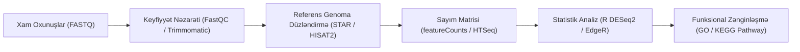

# 🧬 RNA-seq Diferensial Gen Ekspressiyası Boru Kəməri (Pipeline)

Transkriptomika — hüceyrədə müəyyən anda ekspressiya olunan bütün RNT molekullarının (mRNA, lncRNA, miRNA) tədqiqidir. [[carboxmol_bioinformatics_club|CarboxMol Bioinformatika Klubu]] tələbələri tam bir RNA-seq boru kəmərini icra etməyi öyrənirlər.

---

## 🔄 Tam İş Axını (Step-by-Step Pipeline)

### 1. Keyfiyyət Nəzarəti (Quality Control):
* **FastQC:** Phred skoru ($Q \ge 30$, yəni xəta ehtimalı $< 0.1\%$), adapter kontaminasiyası, GC meyli yoxlanılır.
* **Trimmomatic / Cutadapt:** Aşağı keyfiyyətli uclar və sequencing adapterləri təmizlənir.

### 2. Düzləndirmə (Splice-Aware Alignment):
* Eukariot mRNA-larında intronlar splaysinq olunduğundan standart DNT düzləndiriciləri (BWA, Bowtie2) yaramır.
* **STAR (Spliced Transcripts Alignment to a Reference)** və ya **HISAT2** kimi splaysinqi tanıyan alətlərdən istifadə olunaraq BAM faylı əldə edilir.

### 3. Kəmiyyət Təyini (Quantification):
* **featureCounts:** Gen annotasiya faylı (GTF/GFF3) əsasında hər bir genə neçə oxunuşun (*reads*) düşdüyü hesablanır və xam matris formalaşdırılır.

### 4. [[deseq2_bioconductor|DESeq2]] ilə Diferensial İfadə Analizi:
* Median-of-Ratios normallaşdırması.
* Dispersiya təxmini və Empirical Bayes sıxılması.
* Qrup fərqi ($p$-adj $< 0.05$ və $|\log_2\text{FC}| > 1$).

### 5. Vizuallaşdırma:
* **Volcano Plot:** X oxunda $\log_2(\text{Fold Change})$, Y oxunda $-\log_{10}(p\text{-adj})$. Yuxarı sol və sağ künclər əhəmiyyətli dərəcədə azalan və artan genləri göstərir.
* **PCA (Principal Component Analysis):** Bioloji replikatların qruplaşmasını və batch effektlərini nümayiş etdirir.

---

## 🔗 Əlaqəli Səhifələr
* [[deseq2_bioconductor]]
* [[biopython]]
* [[annual_syllabus_breakdown]]
