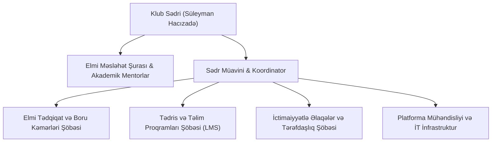

# 🧬 CarboxMol Bioinformatika Klubu (CarboxMol Bioinformatics Club)

**CarboxMol Bioinformatika Klubu** — [[western_caspian_university|Qərbi Kaspi Universiteti (WCU)]] nəzdində fəaliyyət göstərən, hesablama biologiyası, struktur kristalloqrafiya, genomika, transkriptomika və süni intellekt sahələrini birləşdirən aparıcı akademik və tədqiqat tələbə birliyidir.

* **Təsisçi və Sədr:** [[suleyman_hajizadeh|Süleyman Mehdi oğlu Hacızadə]]
* **Ev Sahibi Qurum:** [[western_caspian_university|Qərbi Kaspi Universiteti (WCU)]], Yüksək Texnologiyalar və Təbiət Elmləri Məktəbi
* **Rəsmi Veb Platforma:** [https://carboxmol-bioinformatics-club.github.io](https://carboxmol-bioinformatics-club.github.io)
* **Əsas Repozitoriya:** [`CarboxMol-Bioinformatics-Club / CarboxMol-Bioinformatics-Club`](https://github.com/CarboxMol-Bioinformatics-Club/CarboxMol-Bioinformatics-Club) (🔒 Private Codebase)
* **Məlumat İdarəçiliyi:** Tədqiqat dataları və əsas repozitoriya məxfidir (Private) — giriş icazəsi (Access) üçün müraciət: `suleyman.hacizade.232bioing@wcu.edu.az`
* **Əlaqə:** `suleyman.hacizade.232bioing@wcu.edu.az` | `+994 70 550 69 07`

---

## 🎯 Missiya və Əsas Məqsədlər

1. **Fənlərarası Körpü:** Biologiya və tibb tələbələrinə proqramlaşdırma (Python, R, Linux, Git), kompüter elmləri tələbələrinə isə molekulyar biologiya, genetika və kristalloqrafiya qanunauyğunluqlarını öyrətmək.
2. **Praktiki Tədqiqat Bacarığı:** Yalnız nəzəriyyə ilə kifayətlənməyib, tələbələri real bioloji böyük verilənlər (NGS, RNA-seq, PDB, AlphaFold) üzərində işlətmək.
3. **Qlobal Elmi İnteqrasiya:** [[mrc_lmb_cambridge|Kembric MRC LMB]] ([[garib_murshudov|Prof. Qərib Mürşüdov]]), EMBL-EBI, Wellcome Sanger Institute və digər dünya elmi mərkəzləri ilə elmi təmaslar qurmaq, qonaq mühazirələri təşkil etmək.
4. **Beynəlxalq Məqalə və Layihələr:** Q1 və Q2 indeksli elmi jurnallarda məqalələr dərc etdirmək və beynəlxalq hakatonlarda (iGEM, Bio-Hackathons) universiteti təmsil etmək.

---

## 🏛️ İdarə Heyəti və Təşkilati Quruluş

---

## 💻 Rəqəmsal Ekosistem və Platforma Modulları

* **[[carboxmol_studio|CarboxMol 3D Studiyası]]:** WebGL və Mol* əsasında interaktiv kristalloqrafik vizuallaşdırma mühərriki.
* **[[biomeet_platform|CarboxMol BioMeet]]:** Brauzerdaxili canlı mühazirə zalı və video-qeydiyyatçı.
* **[[seqanalyzer_tool|SeqAnalyzer]]:** DNT/RNT transkripsiyası, tərcümə və ORF axtarışı.
* **Tələbə & Müəllim Portalları:** Avtomatlaşdırılmış tapşırıq yoxlama, qiymətləndirmə və təhlükəsiz qeydiyyat.
* **[[pwa_offline_architecture|PWA Oflayn Dəstək]]:** İnternetsiz laboratoriya mühitində tam funksionallıq.

---

## 🔗 Əlaqəli Səhifələr
* [[suleyman_hajizadeh]]
* [[western_caspian_university]]
* [[garib_murshudov]]
* [[carboxmol_studio]]
* [[annual_syllabus_breakdown]]
* [[system_architecture]]
* [[catalytic_carboxyl_dyads]]
