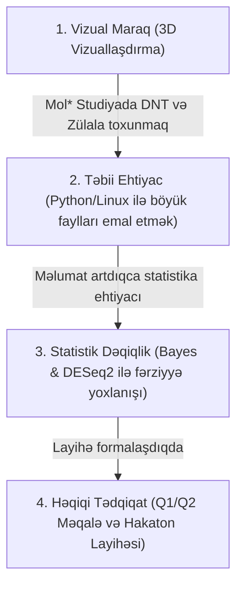

# 💡 Sintez: Hesablama Biologiyasının Bakalavr Təhsilinə İnteqrasiya Metodologiyası

> **Məqsəd:** [[western_caspian_university|Qərbi Kaspi Universiteti]] və [[carboxmol_bioinformatics_club|CarboxMol Bioinformatika Klubu]] təcrübəsi əsasında, biologiya və İT ixtisası tələbələrinin sıfır nöqtəsindən başlayaraq 1 il ərzində beynəlxalq səviyyəli bioinformatika tədqiqatçısına çevrilməsinin metodoloji modelini ümumiləşdirmək.

---

## 🚧 Ənənəvi Tədrisin İki Böyük Ziddiyyəti (The Two Silos)

1. **Bioloqların "Kod Qorxusu":** Biologiya və biotexnologiya tələbələri canlı sistemlərin mexanizmini dərindən başa düşsələr də, terminal, Python və riyazi statistikadan çəkinirlər.
2. **Kompüter Mühəndislərinin "Biologiya Çətinliyi":** İT və kompüter mühəndisliyi tələbələri mürəkkəb alqoritmləri rahat qursalar da, genlərin tənzimlənməsi, splaysinq və ya zülalların protonlaşma incəliklərini dərk etməkdə çətinlik çəkirlər.

---

## 🏆 CarboxMol 4 Mərhələli Həll Modeli

1. **1-ci Ay: Vizual Başlanğıc (No-code / Low-code):** Tələbə əvvəlcə [[carboxmol_studio|CarboxMol 3D Studiyası]]nda `1BNA`, `4I8V` və `4GV1` molekullarını fırladır, aktiv ciblərə baxır və gözü ilə görür.
2. **2-ci–4-cü Aylar: Skriptləşdirmə Zərurəti:** Minlərlə sekvensi əllə emal etməyin mümkünsüzlüyü dərk edildikdə [[biopython|Biopython]] və Linux terminalı təbii ehtiyac kimi mənimsənilir.
3. **5-ci–8-ci Aylar: Riyazi və Statistik Yetkinlik:** [[bayesian_statistics_in_structural_biology|Bayes statistikası]] və [[deseq2_bioconductor|DESeq2]] vasitəsilə tələbə $p$-dəyərlərinin və ehtimal paylanmalarının bioloji qərarlara necə təsir etdiyini görür.
4. **9-cu–12-ci Aylar: Müstəqil Elmi İstehsal:** [[journal_club_framework|Journal Club]] müzakirələri və [[alphafold_and_ai_protein_folding|AlphaFold]] modelləri əsasında tələbə komandaları orijinal elmi fərziyyə irəli sürür və məqalə yazır.

---

## 🔗 Əlaqəli Səhifələr
* [[annual_syllabus_breakdown]]
* [[journal_club_framework]]
* [[carboxmol_bioinformatics_club]]
* [[suleyman_hajizadeh]]
* [[garib_murshudov]]
